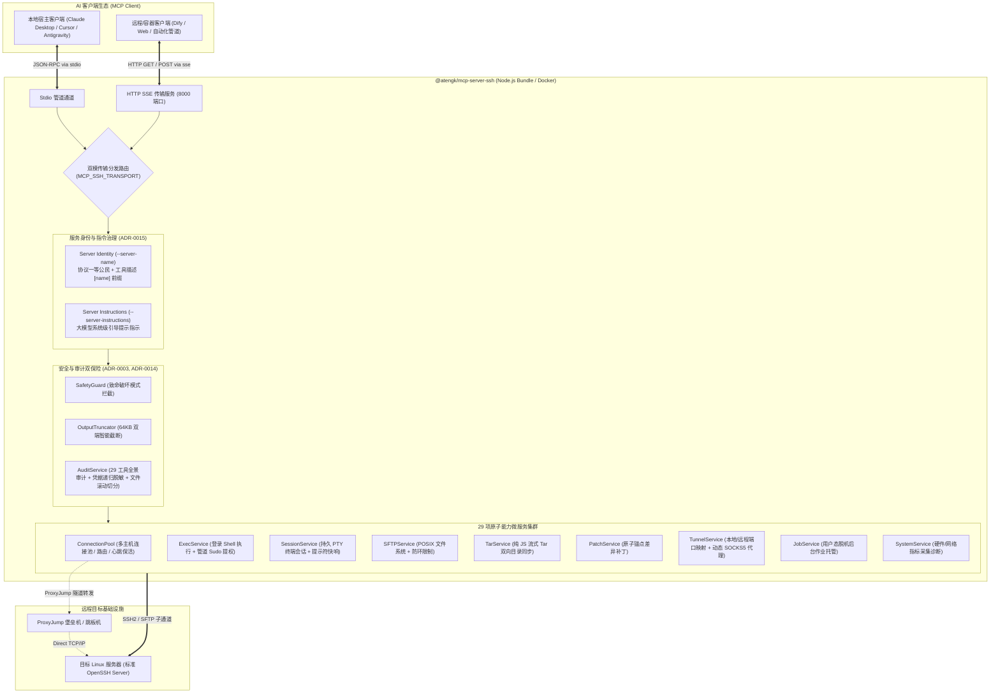

# @atengk/mcp-server-ssh

[](https://www.npmjs.com/package/@atengk/mcp-server-ssh)
[](https://github.com/atengk/mcp-server-ssh/releases)
[](https://github.com/atengk/mcp-server-ssh/actions/workflows/ci.yml)
[](./LICENSE)
[](./CONTRIBUTING.md)
[](https://nodejs.org/)
[](https://www.typescriptlang.org/)
[](https://modelcontextprotocol.io/)
[](./src)

基于标准 **OpenSSH 协议** 深度连接与操控 Linux/Unix 系统的 **Model Context Protocol (MCP)** 服务。为大语言模型（LLM）和 AI 智能体（Claude Desktop、Cursor、Antigravity、Cline 等）提供安全、可控、零侵入的远程终端执行与 POSIX 文件系统管理基础设施。

> 💡 **版本更新日志 (Release Notes)**：每一个正式版本的详细变动明细、修复记录与贡献者致谢均由系统自动维护，可直接前往 [GitHub Releases](https://github.com/atengk/mcp-server-ssh/releases) 查看最新记录。

---

## 🌟 核心特性 (Features)

- **🌐 零侵入标准协议直连**：目标 Linux 主机仅需原生 OpenSSH 服务，绝不安装任何专有 Agent 或 HTTP 守护进程（[ADR-0001](docs/adr/0001-direct-openssh-protocol.md)）。
- **⚡ 双模命令执行引擎**（[ADR-0002](docs/adr/0002-dual-execution-modes.md)）：
  - **无状态执行 (`ssh_exec`)**：单命令独立通道，默认包装为登录 Shell（`bash -l -c`）以完整继承用户环境变量与 `PATH`，精确捕获退出码、耗时与标准输出/错误；支持管道隐式注入凭据的 **零命令行泄露安全 Sudo 提权**（[ADR-0011](docs/adr/0011-zero-leak-sudo-and-unified-tunnel-governance.md)）。
  - **交互式会话 (`ssh_session_*`)**：基于 PTY 伪终端维持常驻会话流，支持流式增量回显、正则提示符监听（`expectPattern`）与 `\x03` (Ctrl+C) 中断控制信号。
- **⏱️ 用户态脱机解耦后台作业 (`ssh_job_*`)**：通过系统解耦技术在远端独立托管耗时脚本、大文件拉取或构建任务，支持退出码精准判定与增量日志流式追踪，连接断开任务不终止（[ADR-0010](docs/adr/0010-detached-background-jobs-architecture.md)）。
- **📁 高级 POSIX SFTP 管理与流式归档**：
  - **精准文本差异补丁 (`sftp_patch_file`)**：基于目标锚点块校验的局部精准替换，避免大文件全量覆写（[ADR-0009](docs/adr/0009-remote-file-diff-patching.md)）；
  - **纯 JS 流式 Tar 目录双向同步 (`sftp_*_dir`)**：支持排除过滤与自动继承 `.gitignore`，零 C++ 原生编译依赖（[ADR-0008](docs/adr/0008-pure-js-tar-directory-transfer.md)）；
  - **基础文件管理**：单文件安全读写（内置防撑爆阈值）、元数据获取、目录递归建删与软链接防环保护。
- **🔌 三位一体网络隧道治理 (`ssh_forward_port`)**：统一管控本地转发（Local）、远程暴露（Remote）与 **纯 JS RFC 1928 动态 SOCKS5 代理**，内置空闲超时自动熔断与物理断连级联回收（[ADR-0011](docs/adr/0011-zero-leak-sudo-and-unified-tunnel-governance.md)）。
- **🏷️ 多实例服务标识与引导指示 (`--server-name` / `--server-instructions`)**：协议级一等公民下发，在多服务并存时向大模型精准传递系统角色定位，工具描述自动修饰紧凑前缀（[ADR-0015](docs/adr/0015-multi-instance-server-identity-and-instructions.md)）。
- **📜 全景生命周期安全审计 (`AuditService`)**：记录全量 29 个原子工具调用的调用源、入参深度凭据脱敏（密码/私钥自动打码掩饰）与执行耗时，支持纯 Node 原生免依赖多文件轮转切分（[ADR-0014](docs/adr/0014-audit-trail-and-security-compliance.md)）。
- **🩺 四维全景自检排障套件 (`--doctor`)**：涵盖 Runtime 运行时、本地 OpenSSH 密钥链、配置合规性与目标连通性全方位秒级诊断巡检（[ADR-0013](docs/adr/0013-cli-suite-and-health-doctor.md)）。
- **🛡️ 严格安全防护双保险**（[ADR-0003](docs/adr/0003-safety-guard-and-output-truncation.md)）：
  - **前置安全守卫 (`SafetyGuard`)**：实时拦截全盘强删（`rm -rf /`）、磁盘覆写（`dd`/`mkfs`）、关机重启（`reboot`/`shutdown`）及 Fork 炸弹等致命破坏，支持 `dryRun` 演练。
  - **智能防爆截断 (`OutputTruncator`)**：单次输出实施 64KB 双端智能截断（保留前 8KB 标头与后 56KB 最新日志），自动清洗 ANSI 终端转义符，保护 LLM 上下文不崩溃。
- **📦 免安装一键即用**：打包为独立单文件 Bundle，全球用户通过 `npx` 零依赖即开即用（[ADR-0004](docs/adr/0004-distribution-and-registry-strategy.md)）。

---

## 🚀 快速上手 (Quick Start)

无需 git clone 或本地编译，在任何支持 MCP 的宿主客户端配置文件（如 Claude Desktop 的 `claude_desktop_config.json`、Cursor 的 `mcp.json` 或 Antigravity / Cline 对应配置）中添加如下配置即可直接启动：

### 通用 MCP 客户端基础配置模板

```json
{
  "mcpServers": {
    "ssh": {
      "command": "npx",
      "args": ["-y", "@atengk/mcp-server-ssh"],
      "env": {
        "MCP_SSH_HOST": "192.168.1.100",
        "MCP_SSH_PORT": "22",
        "MCP_SSH_USER": "root",
        "MCP_SSH_KEY_PATH": "/Users/yourname/.ssh/id_ed25519"
      }
    }
  }
}
```
> 💡 **向后兼容提示**：服务已全面升级为规范的 `MCP_SSH_*` 专属命名空间，同时 100% 透明向下兼容遗留的 `SSH_*` 环境变量，老用户无需修改已有配置即可平滑升级。

---

## ⚙️ 5 大连接场景配置矩阵 (Scenarios)

针对不同网络拓扑与鉴权需求，提供开箱即用的配置范例：

### 场景 1：密码账密直连 (最简临时测试)
```json
{
  "mcpServers": {
    "ssh": {
      "command": "npx",
      "args": ["-y", "@atengk/mcp-server-ssh"],
      "env": {
        "MCP_SSH_HOST": "192.168.1.100",
        "MCP_SSH_PORT": "22",
        "MCP_SSH_USER": "root",
        "MCP_SSH_PASSWORD": "your_secure_password"
      }
    }
  }
}
```

### 场景 2：公私钥免密直连 (生产环境规范推荐)
支持物理文件路径、原始 PEM 文本与 Base64 编码三种形态：
```json
{
  "mcpServers": {
    "ssh": {
      "command": "npx",
      "args": ["-y", "@atengk/mcp-server-ssh"],
      "env": {
        "MCP_SSH_HOST": "192.168.1.100",
        "MCP_SSH_PORT": "22",
        "MCP_SSH_USER": "root",
        "MCP_SSH_KEY_PATH": "D:/files/server/id_ed25519",
        "MCP_SSH_KEY_PASSPHRASE": "optional_passphrase"
      }
    }
  }
}
```
> 💡 **免文件挂载小妙招**：在容器或无文件系统环境中，可直接将私钥 Base64 字符串赋值给 `MCP_SSH_PRIVATE_KEY_BASE64`（或 PEM 文本赋值给 `MCP_SSH_PRIVATE_KEY`），服务将自动解码，无需挂载任何本地私钥文件！  
> 💡 **Windows 提示**：本地路径强烈推荐统一使用正斜杠（如 `"D:/files/server/id_ed25519"`），Node.js 原生完美支持，且能彻底避免 JSON 反斜杠转义（`\\`）遗漏导致的解析崩溃。

### 场景 3：直接复用本地 `~/.ssh/config` 别名 (最推荐，省心免配)
直接继承本机既有的公私钥路径、跳板机、自定义端口与 Host 别名：
```json
{
  "mcpServers": {
    "ssh": {
      "command": "npx",
      "args": ["-y", "@atengk/mcp-server-ssh"],
      "env": {
        "MCP_SSH_CONFIG_ALIAS": "my-cloud-vps"
      }
    }
  }
}
```

### 场景 4：企业级 ProxyJump 堡垒机/跳板机隧道
通过公网跳板机（Bastion）安全穿透至隔离内网中的私有目标服务器：
```json
{
  "mcpServers": {
    "ssh": {
      "command": "npx",
      "args": ["-y", "@atengk/mcp-server-ssh"],
      "env": {
        "MCP_SSH_HOST": "10.0.1.50",
        "MCP_SSH_PORT": "22",
        "MCP_SSH_USER": "deploy",
        "MCP_SSH_PROXY_HOST": "bastion.company.com",
        "MCP_SSH_PROXY_PORT": "2222",
        "MCP_SSH_PROXY_USER": "bastion_user"
      }
    }
  }
}
```

### 场景 5：纯空载启动 (在会话中动态管理多主机)
启动时不配置任何环境变量，后续在对话中直接通过自然语言指示 AI 连接或切换不同的主机：
```json
{
  "mcpServers": {
    "ssh": {
      "command": "npx",
      "args": ["-y", "@atengk/mcp-server-ssh"]
    }
  }
}
```

---

## 🌐 环境变量完整速查矩阵 (12-Factor App)

全面遵循现代化 **12-Factor App** 规范，服务提供官方主前缀 `MCP_SSH_*` 规范变量与向下兼容变量双重支持：

| 分类 | 推荐主环境变量 | 宽容兼容变量 | 默认值 / 行为说明 |
| :--- | :--- | :--- | :--- |
| **传输协议** | `MCP_SSH_TRANSPORT` | `SSH_TRANSPORT` / `MCP_TRANSPORT` | `stdio`（本地单机）、`sse`（网络/容器常驻） |
| **服务监听地址**| `MCP_SSH_SERVER_HOST` | `SSH_SERVER_HOST` / `HOST` | SSE 模式监听地址，默认 `0.0.0.0` |
| **服务监听端口**| `MCP_SSH_SERVER_PORT` | `SSH_SERVER_PORT` / `PORT` | SSE 模式监听端口，默认 `8000` |
| **目标主机地址**| `MCP_SSH_HOST` | `SSH_HOST` | 目标 Linux 服务器 IP 或域名（提供时触发自动建连） |
| **目标主机端口**| `MCP_SSH_PORT` | `SSH_PORT` | 目标 SSH 端口号，默认 `22` (1~65535) |
| **认证用户名** | `MCP_SSH_USER` | `SSH_USER` / `SSH_USERNAME` | 登录用户名（缺省自动探测系统用户） |
| **认证密码** | `MCP_SSH_PASSWORD` | `SSH_PASSWORD` | 明文密码（日志与输出中强制掩码 `***` 脱敏） |
| **私钥文件路径**| `MCP_SSH_KEY_PATH` | `SSH_KEY_PATH` / `SSH_PRIVATE_KEY_PATH` | 本地私钥绝对或 `~` 家目录路径 |
| **私钥文本内容**| `MCP_SSH_PRIVATE_KEY` | `SSH_PRIVATE_KEY` | 原始 PEM 格式私钥文本（自动还原 `\n` 转义换行） |
| **Base64 私钥** | `MCP_SSH_PRIVATE_KEY_BASE64`| `SSH_PRIVATE_KEY_BASE64` | **Base64 编码私钥（彻底避免换行丢失，免文件挂载！）** |
| **私钥解密口令**| `MCP_SSH_KEY_PASSPHRASE`| `SSH_KEY_PASSPHRASE` | 若私钥受密码保护，提供解密口令 |
| **配置别名** | `MCP_SSH_CONFIG_ALIAS`| `SSH_CONFIG_ALIAS` | 继承本地 `~/.ssh/config` 中的 Host 别名 |
| **服务身份名称**| `MCP_SSH_SERVER_NAME` | - | 自定义服务唯一命名空间（默认 `mcp-server-ssh`，非默认值触发工具描述前缀） |
| **服务引导指示**| `MCP_SSH_SERVER_INSTRUCTIONS`| - | 系统级服务角色与操作边界引导说明上下文（握手阶段下发给大模型） |
| **安全审计开关**| `MCP_SSH_AUDIT_ENABLED`| - | 是否激活全景审计轨迹（`true`/`false`，配置日志路径时自动开启） |
| **审计日志路径**| `MCP_SSH_AUDIT_LOG_PATH`| - | 审计日志文件绝对/相对路径（缺省时输出至 stderr） |
| **审计切分大小**| `MCP_SSH_AUDIT_MAX_SIZE_MB`| - | 单日志文件滚动轮转阈值（MB），默认 `10` |
| **审计保留份数**| `MCP_SSH_AUDIT_MAX_FILES`| - | 历史切分备份文件保留份数上限，默认 `5` |
| **审计熔断模式**| `MCP_SSH_AUDIT_STRICT` | - | 是否启用审计失败严格熔断（`true`/`false`，默认 `false` 柔性降级） |
| **跳板机主机** | `MCP_SSH_PROXY_HOST` | `SSH_PROXY_HOST` | ProxyJump 堡垒机/跳板机 IP 或域名 |
| **跳板机端口** | `MCP_SSH_PROXY_PORT` | `SSH_PROXY_PORT` | 跳板机端口，默认 `22` |
| **跳板机用户** | `MCP_SSH_PROXY_USER` | `SSH_PROXY_USER` | 跳板机登录用户名 |
| **跳板机密码** | `MCP_SSH_PROXY_PASSWORD`| `SSH_PROXY_PASSWORD` | 跳板机认证密码（可选） |
| **跳板机私钥** | `MCP_SSH_PROXY_PRIVATE_KEY_BASE64`| `SSH_PROXY_PRIVATE_KEY` | 跳板机专用私钥文本或 Base64 编码（可选） |
| **跳板机私钥口令**| `MCP_SSH_PROXY_KEY_PASSPHRASE`| `SSH_PROXY_KEY_PASSPHRASE` | 跳板机私钥解密口令（可选） |
| **建连超时时间**| `MCP_SSH_TIMEOUT` | `SSH_TIMEOUT` | 目标建连超时时间（毫秒），默认 `30000` |
| **心跳保活间隔**| `MCP_SSH_KEEP_ALIVE_INTERVAL`| `SSH_KEEP_ALIVE_INTERVAL` | KeepAlive 心跳间隔（毫秒），默认 `10000` |
| **致命命令逃生门**| `MCP_SSH_ALLOW_DANGEROUS_COMMANDS`| `SSH_ALLOW_DANGEROUS_COMMANDS` | 宽容布尔值（`1`/`true`/`yes`），默认 `false` 严格阻断 |

> 📌 **解析优先级规则**：`MCP_SSH_* (官方标准前缀，最高)` > `SSH_* (向下兼容前缀)` > `系统内置默认推导`。本地执行时会自动探测读取同级目录下的 `.env` 文件。

---

## 🔌 远程服务调用 (SSE 协议客户端接入)

若服务已部署在局域网服务器、NAS（群晖/威联通）或云容器中，MCP 客户端可直接通过标准 HTTP SSE 端点网络接入，无需在客户端本地安装 Node.js 或运行子进程：

```json
{
  "mcpServers": {
    "ssh-remote": {
      "url": "http://192.168.1.100:8000/sse"
    }
  }
}
```

### 服务端点矩阵与健康检查探针

在 SSE 模式下，轻量 HTTP 服务对外暴露以下规范端点：

| 端点路由 | HTTP 方法 | 功能说明 | 响应格式 / 状态 |
| :--- | :--- | :--- | :--- |
| `/sse` | `GET` | 建立长轮询 Server-Sent Events 事件流，协商客户端 Session | `text/event-stream` |
| `/message` | `POST` | 客户端发送 JSON-RPC 消息请求（需携带 `?sessionId=...`） | `application/json` (202 Accepted) |
| `/health` | `GET` | 服务就绪与存活探针（支持 Docker/K8s 容器健康检查） | `application/json` (200 OK) |

探针请求回显范例：
```json
{
  "status": "ok",
  "service": "mcp-server-ssh",
  "version": "1.2.4",
  "timestamp": "2026-10-04T02:00:00.000Z"
}
```

---

## 🐳 生产环境容器化常驻部署 (Docker & Docker Compose)

项目已由 GitHub Actions CI/CD 自动构建并发布官方多架构镜像（全平台支持 `linux/amd64` 与 `linux/arm64`，适配 Intel/AMD x86 服务器、Mac M系列及树莓派/ARM 云主机）。**无需克隆源码仓库，只需单文件配置即可一键秒级拉起常驻守护服务**。

### 1. 使用 Docker Compose 一键拉起（推荐 ⭐⭐⭐⭐⭐）

无需下载整个代码库，仅需下载或新建 `docker-compose.yaml` 即可常驻运行：

```bash
# 方式 A：单行命令直接从 GitHub 拉取配置并启动服务
curl -fsSL https://raw.githubusercontent.com/atengk/mcp-server-ssh/main/docker-compose.yaml -o docker-compose.yaml && docker compose up -d

# 常用运维命令
docker compose logs -f    # 查看服务实时日志
docker compose pull       # 一键更新至官方最新镜像
docker compose down       # 优雅停止服务
```

`docker-compose.yaml` 核心配置参考：
```yaml
services:
  mcp-server-ssh:
    # 官方预构建多架构镜像 (默认最新版，亦可指定具体版本如 :1.2.3)
    image: ghcr.io/atengk/mcp-server-ssh:${MCP_SSH_IMAGE_TAG:-latest}
    container_name: mcp-server-ssh
    restart: unless-stopped
    ports:
      - "8000:8000"
    environment:
      # 启用 SSE 协议常驻服务
      - MCP_SSH_TRANSPORT=sse
      - MCP_SSH_SERVER_HOST=0.0.0.0
      - MCP_SSH_SERVER_PORT=8000

      # 默认目标服务器凭据 (纯环境变量注入，免文件挂载)
      - MCP_SSH_HOST=192.168.1.100
      - MCP_SSH_PORT=22
      - MCP_SSH_USER=root
      - MCP_SSH_PASSWORD=your_secure_password
      # 亦支持私钥文本/Base64 纯环境变量注入:
      # - MCP_SSH_PRIVATE_KEY_BASE64=LS0tLS1CRUdJTi...
    volumes:
      # 可选: 若需要复用宿主机 ~/.ssh/ 凭据 (只读挂载)
      # - ~/.ssh:/home/node/.ssh:ro
```

### 2. 使用 Docker CLI 独立运行

亦可直接使用标准 `docker run` 命令启动（支持 `linux/amd64` 与 `linux/arm64` 双架构）：

```bash
# 方式 A：SSE 远程常驻模式 (后台守护 + 端口映射 + 纯环境变量)
docker run -d \
  --name mcp-server-ssh \
  -p 8000:8000 \
  -e MCP_SSH_TRANSPORT=sse \
  -e MCP_SSH_HOST=192.168.1.100 \
  -e MCP_SSH_USER=root \
  -e MCP_SSH_PASSWORD=your_password \
  ghcr.io/atengk/mcp-server-ssh:1.2.3

# 方式 B：本地 stdio 单次管道模式 (宿主机无需安装 Node.js)
# 客户端直接将 docker run 作为 command 执行，stdio 直接管道透传
docker run -i --rm \
  -e MCP_SSH_TRANSPORT=stdio \
  -e MCP_SSH_HOST=192.168.1.100 \
  -e MCP_SSH_USER=root \
  -e MCP_SSH_PASSWORD=your_password \
  ghcr.io/atengk/mcp-server-ssh:1.2.3
```

---

## 🌐 多服务器连接与集群管理 (Multi-Host Architecture)

`@atengk/mcp-server-ssh` 内置企业级连接池管理器（`ConnectionPool`），原生支持在单个服务内同时维持与调度多台 Linux 主机。根据您的使用习惯，提供三种灵活的架构模式：

### 模式一：单 MCP 实例内的【动态连接池路由】（最灵活、推荐）

只需启动一个通用的 MCP 服务（如上述“场景 5”的空载配置），AI 即可在自然语言对话中随时建立、切换并并发调度多台主机：

#### 跨主机协同调度机制
所有命令与文件工具（`ssh_exec`、`sftp_*` 等）均包含可选参数 `connectionId`：
- **建立连接**：调用 `ssh_connect` 时指定 `connectionId: "prod"` 或 `connectionId: "test"`；
- **定向下发**：传入 `connectionId` 时，请求将精准路由至对应主机的物理通道；未传入时自动路由至当前的默认连接（`Default Connection`）；
- **跨机数据同步**：AI 可在一个任务链中从主机 A 下载文件（`sftp_download(..., connectionId: "test")`），紧接着直接上传至主机 B（`sftp_upload(..., connectionId: "prod")`）！

#### 跨机实战对话范例：
> **用户**：“帮我连上生产机 `192.168.1.100:22` (命名为 `prod`)，再连上测试机 `192.168.1.50:22` (命名为 `test`)。然后对比两台机器的可用内存。”
>
> 🤖 **AI 行为**：
> 1. 调用 `ssh_connect({ host: "192.168.1.100", port: 22, username: "root", connectionId: "prod", setAsDefault: true })`；
> 2. 调用 `ssh_connect({ host: "192.168.1.50", port: 22, username: "dev", connectionId: "test" })`；
> 3. 分别调用 `ssh_exec({ command: "free -m", connectionId: "prod" })` 与 `ssh_exec({ command: "free -m", connectionId: "test" })`；
> 4. 对比两台服务器的内存指标并为您生成直观的可视化对比表格。

---

### 模式二：客户端级别的【静态多实例隔离与大模型精准识别】（物理隔离、互不干扰）

若您在客户端中需要同时挂载多个独立的 SSH 服务分别连接不同安全域的主机（如核心生产机房 vs 开发测试集群），大模型如何明确区分并精准调用对应目标？

`@atengk/mcp-server-ssh` 提供专为大模型设计的 **多实例服务身份标识与引导指示体系 (ADR-0015)**：
1. **CLI 命令行长选项接入**：`--server-name <name>` 与 `--server-instructions <text>`；
2. **规范环境变量接入**：`MCP_SSH_SERVER_NAME` 与 `MCP_SSH_SERVER_INSTRUCTIONS`（CLI 选项优先级高于环境变量）；
3. **协议级一等公民握手**：在服务初始化时直接向客户端与大模型下发唯一服务身份名称及角色操作边界；
4. **工具描述自动紧凑修饰**：所有对外暴露的 29 个 MCP 工具描述前自动透明追加 `[<serverName>] ` 紧凑前缀（如 `[prod-bastion] 无状态执行远程 Bash 命令...`），彻底终结大模型混淆调用目标的隐患！

#### Claude Desktop / Cursor 实战配置示范：

```json
{
  "mcpServers": {
    "ssh-prod": {
      "command": "npx",
      "args": [
        "-y",
        "@atengk/mcp-server-ssh",
        "--server-name", "prod-bastion",
        "--server-instructions", "专用于生产环境核心业务服务器，执行高危变更前必须双重确认"
      ],
      "env": {
        "MCP_SSH_HOST": "10.0.1.100",
        "MCP_SSH_PORT": "22",
        "MCP_SSH_USER": "ops",
        "MCP_SSH_KEY_PATH": "D:/keys/prod_id_ed25519"
      }
    },
    "ssh-dev": {
      "command": "npx",
      "args": [
        "-y",
        "@atengk/mcp-server-ssh",
        "--server-name", "dev-node",
        "--server-instructions", "开发联调测试集群，可自由编译调试与重启容器"
      ],
      "env": {
        "MCP_SSH_HOST": "192.168.1.50",
        "MCP_SSH_PORT": "22",
        "MCP_SSH_USER": "dev",
        "MCP_SSH_PASSWORD": "dev_password"
      }
    }
  }
}
```

* **大模型感知效果**：
  - 工具描述自动前缀化：AI 工具栏中直观呈现 `[prod-bastion] ssh_exec` 与 `[dev-node] ssh_exec`；
  - 角色行为自动对齐：当您向 AI 发出“重启微服务容器”时，AI 会自觉依据 instructions 在测试节点立即执行，而在生产节点前置向您提示风险并请求确认！

---

### 模式三：继承本地 `~/.ssh/config` 集群别名（零凭证泄露）

在宿主机的 `~/.ssh/config` 中配置多主机拓扑（含各自私钥、自定义端口与跳板机），启动服务后，无需在聊天中告知 AI 任何敏感 IP 或密码：
> **用户**：“帮我连上本地配置里的 `ali-prod` 和 `tencent-test` 主机。”  
> 🤖 **AI**：自动通过 `sshConfigAlias` 建立连接并映射路由，安全优雅！

---

---

## 💡 大模型日常提示词与实战指令库 (Prompts & Best Practices)

为让大模型充分发挥 MCP 工具矩阵的最大威力，我们精心整理了系统级引导模版与日常最高频的运维 Prompt 模版。无论是写入客户端配置还是直接粘贴发送，均可即开即用：

### 1. 服务引导指示模版库 (Server Instructions Templates)
通过 `--server-instructions <text>` 参数或 `MCP_SSH_SERVER_INSTRUCTIONS` 环境变量在服务启动时注入，在协议初始化时直接成为大模型的全局行为基准：

#### 模版 A：【生产机房高可用运维型】（安全防御优先，严控破坏性指令）
```text
你是一名管理核心生产服务器的资深 Linux 系统运维专家。
操作原则：
1. 安全第一：执行任何涉及文件删除、配置覆写、服务停止或网络重启的命令前，必须在对话中向用户说明影响面并获得确认；
2. 变更留痕：修改关键配置文件前必须先备份为 .bak；尽量使用 sftp_patch_file 局部更新，严禁全量盲目覆写；
3. 输出精简：命令执行后提炼关键输出、状态码与错误堆栈，禁止向用户输出无意义的原始长日志。
```

#### 模版 B：【开发测试极客与排障型】（自主排查，快速迭代）
```text
你是一名全栈研发与运维专家，负责当前测试集群的持续联调与诊断。
操作原则：
1. 深入探查：遇到服务异常或测试失败，自主调用日志工具、进程查看与网络探针，迅速定位瓶颈；
2. 快速演练：支持对配置文件直接热修并验证语法；耗时编译构建任务优先使用 ssh_job_start 异步脱机执行；
3. 主动总结：每次排查完毕后，输出清晰的排查推演过程与修复建议。
```

#### 模版 C：【安全基线与只读巡检型】（零侵入，仅读不写）
```text
你是一名负责企业资产安全合规的系统审计员。
操作原则：
1. 严格只读：严禁下发任何修改系统配置、写文件、停止服务或启动新进程的写操作；
2. 全景采集：调用 ssh_system_info 与各类只读探针系统化检查内核、开放端口、SSH 配置、Sudo 权限及异常开机启动项；
3. 规范汇报：严格以标准 Markdown 审计报表格式呈现风险隐患、合规评级与加固整改方案。
```

---

### 2. 日常高频实战提示词 (Daily User Prompts)
复制以下提示词并替换其中的占位符，直接在 AI 聊天对话框中下发：

#### 🎯 场景 1：主机全景健康体检与规格采集
> **Prompt 复制即用**：
> ```text
> 帮我全面巡检当前主机的健康状态与规格：
> 1. 查看操作系统架构、发行版与 Linux 内核版本；
> 2. 检查当前 CPU 核心数、实时负载（Load Average）与可用内存比例；
> 3. 列出根分区及挂载数据盘的磁盘空间占用与 Inode 消耗；
> 4. 排查当前处于 LISTEN 状态的公网与内网监听端口。
> 请将所有核心指标汇总为直观的 Markdown 对比卡片。
> ```
> 🛠️ **底层工具链**：`ssh_system_info` / `ssh_exec` (uname, uptime, free, df)

#### 🎯 场景 2：线上故障紧急排查与日志溯源
> **Prompt 复制即用**：
> ```text
> 我们的微服务出现异常波动，请帮我排查系统：
> 1. 抓取 /var/log/syslog 或 /var/log/messages 中最近 10 分钟内的 ERROR/FATAL 级别日志；
> 2. 查看当前 CPU 占用前 5 和内存占用前 5 的进程列表（PID、用户、占用百分比及命令）；
> 3. 分析是否存在僵尸进程、OOM Killer 触发记录或磁盘 I/O 堵塞；
> 4. 给出可能引发故障的根因推断与紧急处置方案。
> ```
> 🛠️ **底层工具链**：`ssh_exec` (grep, ps, dmesg) + `OutputTruncator` (双端 64KB 智能防撑爆)

#### 🎯 场景 3：配置文件安全精准热修 (Patch)
> **Prompt 复制即用**：
> ```text
> 需要微调 Nginx 的连接超时配置：
> 1. 读取 /etc/nginx/nginx.conf 确认当前的 keepalive_timeout 配置；
> 2. 使用差异补丁将 keepalive_timeout 65; 替换为 keepalive_timeout 15; keepalive_requests 1000;；
> 3. 运行 nginx -t 严格校验配置语法；
> 4. 语法通过后平滑重载 Nginx，并确认 worker 进程工作正常。
> ```
> 🛠️ **底层工具链**：`sftp_patch_file` (局部精准替换) + `ssh_exec` (nginx -t, nginx -s reload)

#### 🎯 场景 4：耗时长任务脱机后台托管 (Job)
> **Prompt 复制即用**：
> ```text
> 我需要从远端镜像源拉取一份 10GB 的大文件并在远端执行解压与构建：
> 1. 请使用脱机后台作业（Job）在后台异步启动下载与解包脚本，不要阻塞当前会话；
> 2. 返回分配的 jobId 与系统 pid；
> 3. 每隔数秒帮我流式增量查看最新的日志输出，直到任务顺利完成并确认 exitCode 为 0。
> ```
> 🛠️ **底层工具链**：`ssh_job_start` (脱机后台托管) + `ssh_job_status` + `ssh_job_logs`

#### 🎯 场景 5：本地跨网络穿透与数据库代理隧道 (Tunnel & SOCKS5)
> **Prompt 复制即用**：
> ```text
> 我在本地电脑上需要临时访问目标服务器私网内的 Redis 服务（远端私网 IP 10.0.1.200:6379）：
> 1. 帮我建立一条本地端口转发隧道，将我本机的 16379 映射到远端的 10.0.1.200:6379；
> 2. 设置空闲超时熔断时间为 30 分钟（无连接自动回收，防止资源泄露）；
> 3. 打印隧道建立结果与连接串，并在我联调完成后列出隧道清单以便确认。
> ```
> 🛠️ **底层工具链**：`ssh_forward_port` (模式: local) + `ssh_tunnel_list` + `ssh_tunnel_close`

#### 🎯 场景 6：特权命令安全提权执行 (Sudo)
> **Prompt 复制即用**：
> ```text
> 请帮我以特权身份更新目标服务器上的系统时间同步服务：
> 1. 提权执行 systemctl restart chronyd；
> 2. 检查 chronyc sources 验证上游时间服务器同步状态；
> 注意：请使用安全管道 Sudo 提权机制，密码绝不可暴露在命令行参数或系统日志中。
> ```
> 🛠️ **底层工具链**：`ssh_exec` (`sudo: true` Stdin 隐式管道注入)

#### 🎯 场景 7：工程代码与静态资产极速双向归档 (Tar Stream)
> **Prompt 复制即用**：
> ```text
> 帮我把本地的项目工程目录 ./my-project 上传并解压到服务器的 /opt/app/ 目录下：
> 1. 采用纯 JS 流式 Tar 目录传输；
> 2. 自动继承并读取 .gitignore，排除 node_modules、.git 及 *.log 等无用目录与临时文件；
> 3. 上传完成后校验目标目录的文件结构完整性。
> ```
> 🛠️ **底层工具链**：`sftp_upload_dir` (流式 Tar + 排除规则) + `sftp_list_dir`

#### 🎯 场景 8：多主机集群对比与资产调度 (Multi-Host)
> **Prompt 复制即用**：
> ```text
> 帮我同时调度生产机 prod 与测试机 dev：
> 1. 分别提取两台机器上的 /etc/hosts 文件与关键环境变量；
> 2. 对比两者的网段映射与解析差异，指出测试环境遗漏的域名配置；
> 3. 从 prod 节点下载 /opt/app/schema.sql 并直接部署传输至 dev 节点对应目录。
> ```
> 🛠️ **底层工具链**：`ssh_connect` (多 connectionId) + `sftp_download` + `sftp_upload`

---

## 🛠️ 全量 29 个原子工具矩阵参考 (Tools)

服务基于单一职责与高内聚原则，对外提供覆盖 Linux 运维全生命周期的 29 项工业级原子工具：

| 领域模块 | 工具名称 | 核心职责说明 | 关键输入参数 |
| :--- | :--- | :--- | :--- |
| **基础运维 (2)** | `ssh_ping` | 测试 MCP 服务存活、当前版本及网络握手延迟 | `message?` |
| | `ssh_system_info` | 采集远程系统硬件架构、CPU/内存指标与网络监听摘要 | `connectionId?` |
| **连接管理 (5)** | `ssh_connect` | 建立新 SSH 物理连接或依据本地配置别名预载入 | `host`, `port`, `username`, `password?`, `privateKey?`, `proxyJump?`, `sshConfigAlias?` |
| | `ssh_disconnect` | 安全关闭并级联释放指定的物理连接及挂载隧道 | `connectionId` |
| | `ssh_list_connections` | 列出连接池中所有活跃连接、建连时间与默认路由标记 | 无 |
| | `ssh_list_config_hosts` | 解析并列出本机 `~/.ssh/config` 预设的所有别名与主机 | 无 |
| | `ssh_list_targets` | **[统一发现]** 一次性返回活跃连接与配置别名双重视图 | 无 |
| **命令执行 (1)** | `ssh_exec` | 无状态执行远程 Shell 命令（支持 Sudo 隐式提权与 dryRun 演练） | `command`, `connectionId?`, `cwd?`, `sudo?`, `sudoPassword?`, `timeoutMs?`, `dryRun?`, `dangerouslySkipSafetyCheck?` |
| **交互终端 (3)** | `ssh_session_start` | 启动常驻交互式 PTY 伪终端会话流（支持调整窗口行列） | `connectionId?`, `cols?`, `rows?` |
| | `ssh_session_send` | 向伪终端注入按键流、控制信号（如 `\x03` Ctrl+C）或提示符快响 | `sessionId`, `input`, `expectPattern?`, `waitForMs?` |
| | `ssh_session_close` | 优雅销毁指定的交互式伪终端会话并回收系统资源 | `sessionId` |
| **文件传输 (8)** | `sftp_read_file` | 读取远程文本文件（内置 512KB 防撑爆阈值） | `remotePath`, `connectionId?`, `encoding?`, `maxBytes?` |
| | `sftp_write_file` | 覆写远程文本文件（支持自动递归创建父级目录） | `remotePath`, `content`, `createDirectories?` |
| | `sftp_list_dir` | 浏览远程目录，返回 POSIX 权限、大小与时间元数据 | `remotePath`, `connectionId?` |
| | `sftp_stat` | 获取指定远程路径的详细 POSIX 状态与属性 | `remotePath`, `connectionId?` |
| | `sftp_mkdir` | 创建远程目录（默认自动级联 `mkdir -p`） | `remotePath`, `recursive?` |
| | `sftp_remove` | 删除远程文件或目录（支持级联删除与防环保护） | `remotePath`, `recursive?` |
| | `sftp_upload` | 将宿主机单文件极速上传至远程目标路径 | `localPath`, `remotePath`, `connectionId?` |
| | `sftp_download` | 将远程单文件极速下载至宿主机本地目标路径 | `remotePath`, `localPath`, `connectionId?` |
| **流式与差异 (3)**| `sftp_upload_dir` | **[纯 JS 流式 Tar]** 目录极速打包上传，支持正则与 .gitignore 排除 | `localPath`, `remotePath`, `excludePatterns?`, `useGitignore?` |
| | `sftp_download_dir` | **[纯 JS 流式 Tar]** 远程目录极速打包下载至本地 | `remotePath`, `localPath`, `excludePatterns?` |
| | `sftp_patch_file` | **[原子差异补丁]** 基于目标块锚点唯一性校验的局部精准热修 | `remotePath`, `targetContent`, `replacementContent`, `allowMultiple?` |
| **端口转发 (3)** | `ssh_forward_port` | **[三位一体]** 管控 local/remote 端口映射及动态 SOCKS5 代理 | `mode` ("local"\|"remote"\|"socks5"), `localPort`, `remoteHost?`, `remotePort?`, `idleTimeoutSeconds?` |
| | `ssh_tunnel_list` | 列出当前所有活跃隧道、端口映射、转发模式与流量统计 | `connectionId?` |
| | `ssh_tunnel_close` | 手动关闭指定的端口转发隧道或代理服务 | `tunnelId` |
| **后台作业 (5)** | `ssh_job_start` | **[脱机作业]** 在远程后台异步启动长耗时命令（记录 PID 与状态） | `command`, `jobId?`, `cwd?` |
| | `ssh_job_status` | 检查后台作业的活跃进程状态、运行耗时与最终退出码 | `jobId` |
| | `ssh_job_logs` | 分页或流式增量抓取后台作业的标准输出与错误日志 | `jobId`, `tailLines?`, `offsetBytes?` |
| | `ssh_job_kill` | 向后台作业发送优雅 SIGTERM 及强制 SIGKILL 终止进程 | `jobId` |
| | `ssh_job_clean` | 清理已终结后台作业在远端暂存的临时日志与状态目录 | `jobId` |

---

## 🛡️ 安全防御矩阵与演练模式 (SafetyGuard)

为了防范 AI 模型幻觉引发毁灭性系统灾难，服务内置了强力前置守卫：
- **实时拦截黑名单**：自动阻断系统全盘强删（`rm -rf /`、`rm -rf /*`）、块设备覆写（`mkfs`、`dd if=... of=/dev/...`）、系统停机关机（`reboot`、`shutdown`、`init 0`）、清空根权限（`chmod -R 000 /`）及 Fork 炸弹等。
- **运维受控逃生门**：针对系统管理员确需执行重启等特殊运维任务的场景，服务提供双重授权逃生门机制——必须在服务端配置环境变量 `SSH_ALLOW_DANGEROUS_COMMANDS=true`，且在 `ssh_exec` 调用时显式传入 `dangerouslySkipSafetyCheck: true` 方可放行，单方面调用将被严格拒绝。
- **实机绝对安全**：拦截发生在客户端下发前，**危险字节流绝对不会走出本地网络，远端物理通道零受影响**。
- **安全演练模式 (`dryRun`)**：在调用 `ssh_exec` 时传入 `dryRun: true`，可在不下发执行的前提下验证命令是否符合安全规则。

---

## ❓ 常见问题与排坑指南 (FAQ & Troubleshooting)

<details>
<summary><b>Q1: Windows 宿主机下私钥文件路径该如何填写？</b></summary>
<br>
推荐直接使用跨平台通用的正斜杠格式，例如 <code>D:/files/server/id_ed25519</code>，Node.js 原生支持且能规避 JSON 字符转义问题；若坚持使用 Windows 传统反斜杠，必须写成双反斜杠转义形式 <code>D:\\files\\server\\id_ed25519</code>。
</details>

<details>
<summary><b>Q2: 为什么尝试读取大日志文件时报错“超出最大读取限制”？</b></summary>
<br>
为了防止数十兆或上百兆的日志文本一次性灌入撑爆宿主客户端内存或消耗百万级 Token，<code>sftp_read_file</code> 默认设置了 512KB 安全阈值。对于大型日志，建议使用 <code>sftp_download</code> 下载到本地，或者使用 <code>ssh_exec</code> 运行 <code>tail -n 200</code> 进行截取。
</details>

<details>
<summary><b>Q3: 连接时提示“All configured authentication methods failed”怎么排查？</b></summary>
<br>
通常由于目标服务器禁用了该认证方式引起：<br>
1. 若使用公私钥，检查目标机 <code>/etc/ssh/sshd_config</code> 是否配置了 <code>PubkeyAuthentication yes</code>，以及目标机 <code>~/.ssh/authorized_keys</code> 权限是否为 <code>600</code>；<br>
2. 若使用密码，检查 <code>PasswordAuthentication yes</code> 是否开启。
</details>

<details>
<summary><b>Q4: 为什么执行带有 sudo 的特权命令时会提示输入密码？如何安全执行？</b></summary>
<br>
传统无状态命令执行不分配交互终端，若目标机 sudo 需要密码会导致命令一直等待输入直至超时。为此，<code>ssh_exec</code> 内置了 <b>零命令行泄露安全 Sudo 提权机制</b>（<a href="docs/adr/0011-zero-leak-sudo-and-unified-tunnel-governance.md">ADR-0011</a>）：调用时仅需传入 <code>sudo: true</code>（若未复用建连密码，可补充 <code>sudoPassword</code>），服务将通过 Stdin 内部隐式安全管道注入密码，密码绝对不会泄露在命令行参数或系统 <code>ps</code> 进程树中！
</details>

<details>
<summary><b>Q5: 如何在不启动 MCP 客户端的情况下排查本地环境或网络连通性问题？</b></summary>
<br>
直接在宿主机终端中运行内置的四维自检套件：<br>
<code>npx @atengk/mcp-server-ssh --doctor</code><br>
它将在数秒内对 Node.js 运行时、本地 <code>~/.ssh/</code> 资产与密钥、环境变量规范合规性（含安全审计目录权限与服务标识）以及目标主机 SSH 握手进行全景只读体检，并给出精准排障指引。
</details>

---

## 🏗️ 架构拓扑 (Architecture)



---

## 🏛️ 架构决策记录 (Architecture Decision Records)

本项目严格遵循 **架构决策记录 (ADR)** 演进机制，每一次重大决策均经过多轮技术推演与方案权衡：

- [ADR-0001: 采用零侵入标准 OpenSSH 协议直连](docs/adr/0001-direct-openssh-protocol.md)
- [ADR-0002: 双模命令执行引擎设计（独立通道与持久 PTY 会话）](docs/adr/0002-dual-execution-modes.md)
- [ADR-0003: 前置命令安全拦截与 64KB 双端输出防爆策略](docs/adr/0003-safety-guard-and-output-truncation.md)
- [ADR-0004: 作用域包命名与三位一体 MCP 生态分发矩阵](docs/adr/0004-distribution-and-registry-strategy.md)
- [ADR-0005: 规范化环境变量与双传输常驻容器部署](docs/adr/0005-canonical-env-and-sse-containerization.md)
- [ADR-0006: 开源工程化规范与全自动流水线基建](docs/adr/0006-oss-template-engineering-standards.md)
- [ADR-0007: 容器镜像多架构自动发布与版本标签治理](docs/adr/0007-container-tagging-and-registry-hygiene.md)
- [ADR-0008: 纯 JS 流式 Tar 双向目录传输与排除过滤](docs/adr/0008-pure-js-streaming-tar-for-directory-sync.md)
- [ADR-0009: 统一目标发现与原子差异补丁工具扩展](docs/adr/0009-tool-consolidation-and-killer-extensions.md)
- [ADR-0010: 用户态脱机后台作业与生命周期解耦架构](docs/adr/0010-detached-background-jobs-architecture.md)
- [ADR-0011: 零泄露安全 Sudo 提权与三位一体隧道治理](docs/adr/0011-zero-leak-sudo-and-unified-tunnel-governance.md)
- [ADR-0012: 12-Factor 规范环境变量强类型治理](docs/adr/0012-strict-environment-variable-governance.md)
- [ADR-0013: CLI 命令选项体系与四维全景自检套件](docs/adr/0013-cli-flags-and-doctor-diagnostics.md)
- [ADR-0014: 全生命周期安全审计轨迹与零泄密凭据脱敏架构](docs/adr/0014-audit-trail-and-security-compliance.md)
- [ADR-0015: 多实例服务身份标识与引导指示架构](docs/adr/0015-multi-instance-server-identity-and-instructions.md)
- [ADR-0016: 全面集成 oss-template 工业级开源工程基建与 Apache-2.0 协议切换架构](docs/adr/0016-oss-template-integration-and-apache-license-migration.md)

---

## 🌐 官方生态与目录收录 (Community Catalogs)

本项目支持通过标准 PR / Issue 形式收录至全球 MCP 目录：
- **Model Context Protocol 官方社区**：[modelcontextprotocol/servers](https://github.com/modelcontextprotocol/servers)
- **Glama MCP Directory**：[glama.co/mcp/servers](https://glama.co/mcp/servers)
- **PulseMCP Registry**：[pulsemcp.com](https://www.pulsemcp.com)
- **Awesome MCP Servers**：[punkpeye/awesome-mcp-servers](https://github.com/punkpeye/awesome-mcp-servers)

---

## 🤝 参与贡献 (Contributing)

欢迎任何形式的贡献、优化建议与缺陷反馈！本项目遵循现代化 GitHub Flow 与 Conventional Commits 规范，提供了开箱即用的本地工程化工具链：

```bash
# 1. 一键初始化本地环境并激活 Git 提交守门钩子
npm run setup

# 2. 启动 TypeScript 热重载监听与运行全量单测
npm run dev && npm test

# 3. 启动交互式向导规范化组装 Conventional Commit 提交
npm run commit
```

详细的分支策略、二元流水线机制、发版向导与开发规范请参阅完整的 **[贡献指南 (CONTRIBUTING.md)](./CONTRIBUTING.md)**。

---

## 📄 开源许可证 (License)

本项目基于 [Apache License 2.0 (Apache-2.0)](./LICENSE) 协议完全开源。
